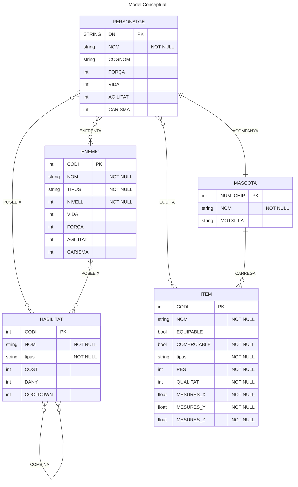

## Explicació
Per fer el diagrama mermaid primer fem les taules posen el nombre de la taula i omplin els seus valors dintre de `{ }` podem definir valors posen el seu nom amb el seu tipus com els següents:

```
string	Text
char	Un sol caràcter
boolean / bool	verdader o fals
int / integer	Nombre enter
```
Aquí estan els tipus de relació que poden tenir les taules entre eelles podem tenir les següents possibilitats depenen del tipus de comportament que poden tenir entre elles com per exemple `||--|| : acció o fet` com per exemple un personatge pot acompanyar una mascota_

>   |o : Un o zero
>
>    || : Exactament un
>
>    }o : Molts o zero
>
>   }| : Molts o un
>
>    o| : Zero o un

També per resoldre els dubtes o problemes que vaig tenir fent el diagrama vaig utilitzar la documentació oficial de **[mermaid](https://mermaid_ai/open-source/syntax/entityRelationshipDiagram_html)**_


